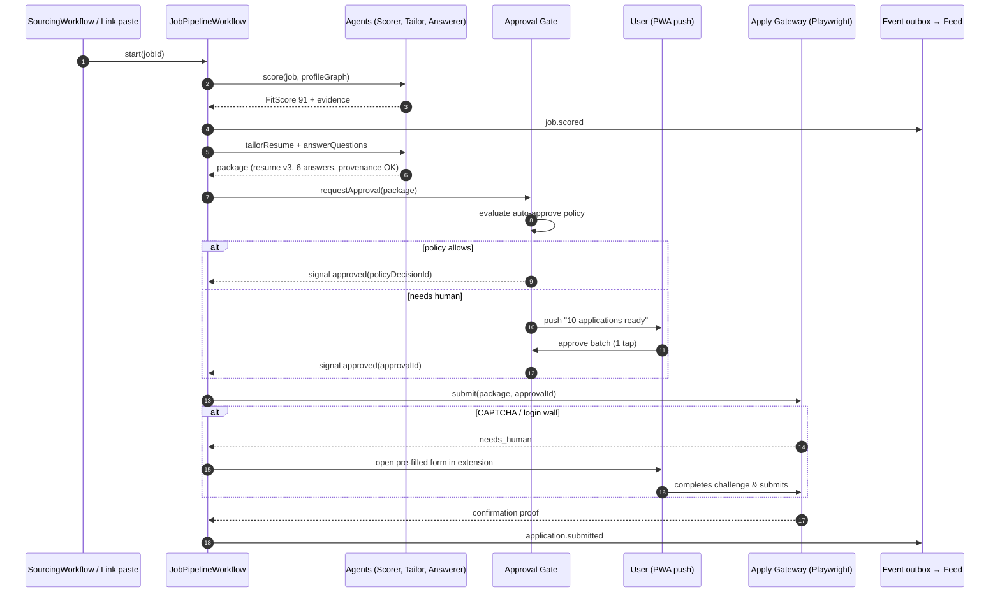
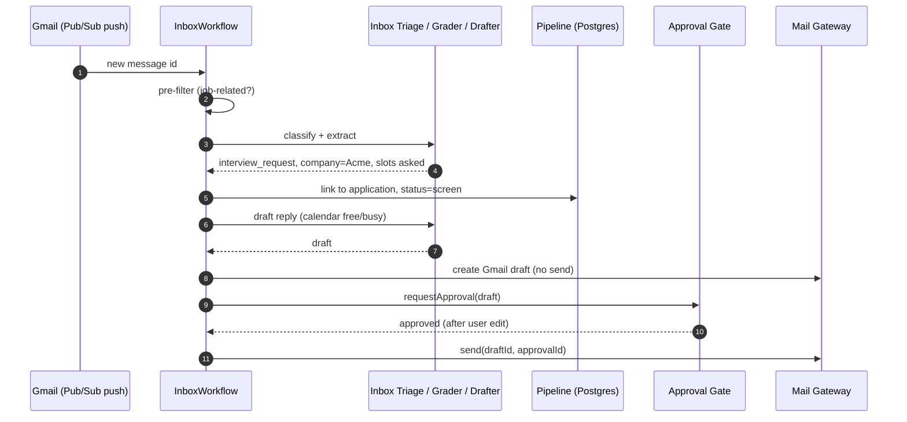
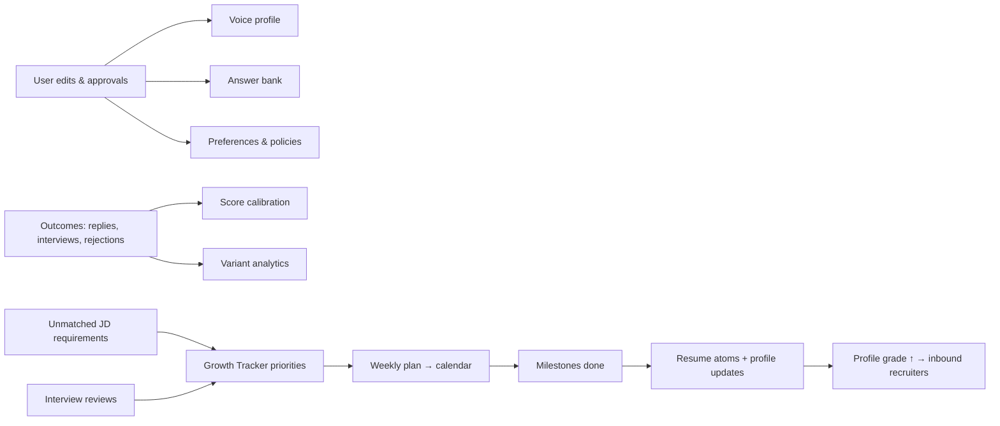
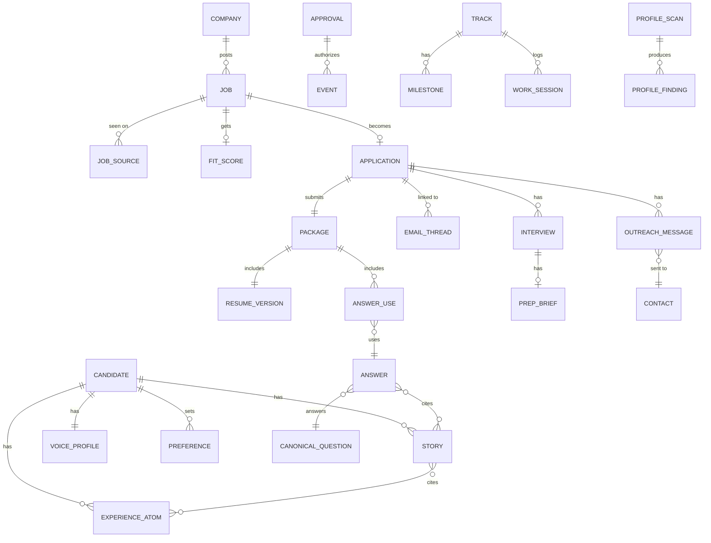

# System Design

The one-picture view is [system-architecture.svg](system-architecture.svg). This document explains it.

## 1. Design in one paragraph
A **TypeScript monorepo** with a Next.js web app (PWA) and a Chrome extension as clients, an API/BFF, and a fleet of **agent workers orchestrated by Temporal**. Agents *think* (Claude API) and *propose*; they never act on the outside world directly. All side effects — submitting an application, sending an email, writing to the calendar, opening a GitHub PR — go through **Action Gateways** that require an approval record or a matching auto-approve policy from the **Approval Gate**. Every step writes a domain event to a Postgres outbox that streams to the UI's **activity feed**. A **Candidate Profile Graph** (experience atoms, stories, voice profile, answer bank) is the single source of truth that every generator must cite.

## 2. Layers & components

### Clients
| Component | Responsibility |
|---|---|
| **Web app (Next.js PWA)** | Today view, approval queue, job feed, pipeline kanban, job inbox, growth tracker, profile grade, run inspector. Mobile push for 1-click approvals. |
| **Browser extension (MV3)** | Capture JD from any page (SRC-002); read user's own LinkedIn profile for audit (PRF-002); **human-handoff** — open a pre-filled application in the user's own session when a CAPTCHA/login appears (APPLY-006); read course progress pages (GRW-005). |

### Edge
| Component | Responsibility |
|---|---|
| **API / BFF** | Auth (passkey, single user first), REST/tRPC for the app, webhook receivers (Gmail Pub/Sub push, GitHub), extension bridge. Starts/signals Temporal workflows. |
| **Realtime hub** | Tails the event outbox and pushes to clients over SSE (OBS-002). |

### Orchestration — Temporal (ADR-0001)
Long-lived, durable workflows; agents run as **activities**. Human approvals are Temporal **signals**, so a workflow can wait days for the user without holding resources and resumes exactly where it left off.

| Workflow | Trigger | Steps (activities) |
|---|---|---|
| `SourcingWorkflow` | Cron (per watchlist tier) | poll ATS boards / feeds → normalize → dedupe → start `JobPipeline` per new job |
| `JobPipelineWorkflow` | Per job (ingest or link paste) | extract → score → (skip \| queue) → tailor resume → answer questions → assemble package → **policy check** → auto-approve or **await approval signal** → submit via Apply Gateway → capture proof → `submitted` |
| `InboxWorkflow` | Gmail push per message | pre-filter → classify → link to application → update status → (grade recruiter) → draft reply → **await approval** → send via Mail Gateway |
| `FollowUpWorkflow` | Timer per application stage | wait N days → if no reply → draft nudge → await approval |
| `OutreachWorkflow` | Per application (opt-in) | find people → find/verify emails → draft → await approval → send → sequence |
| `InterviewWorkflow` | Interview detected | build prep brief → propose prep blocks → await approval → write calendar → reminders → post-interview review → thank-you draft |
| `ProfileScanWorkflow` | Weekly cron / on demand | GitHub + site scan (server) + LinkedIn scan (extension) → grade → fix drafts → await approval (PRs) |
| `GrowthPlanWorkflow` | Weekly cron | gather progress signals → plan week under capacity + balance rules → await approval → write calendar blocks |

### Agents (Claude-powered activities)
Each agent is a narrow, testable unit: typed input, typed (structured-output) result, a small tool set, a versioned prompt, and an eval suite. None holds credentials for outbound actions.

| Agent | Model work | Tools (read-only unless noted) |
|---|---|---|
| **Extractor** | HTML/text → normalized `Job` | fetch page, ATS API clients |
| **Scorer** | JD vs. profile graph → Fit Score + evidence | profile graph search |
| **Tailor** | select/reword atoms → resume + provenance | profile graph, renderer, ATS-parse checker |
| **Answerer** | canonical-question match, draft in voice | answer bank, story search, company research |
| **Form Mapper** | unknown form DOM → field map | browser snapshot (no submit) |
| **Inbox Triage** | classify + extract entities | pipeline lookup |
| **Reply Drafter** | draft replies | calendar free/busy, thread history, answer bank |
| **Recruiter Grader** | A–F with reasons | preferences, company data |
| **Outreach** | pick people, draft emails | contact providers, public web research |
| **Profile Auditor** | audit + grade + fix drafts | GitHub API, Lighthouse, site fetch, extension snapshot |
| **Prep Coach** | briefs, mock interviews, review | company research, story bank |
| **Growth Planner** | weekly plan, gap signals | tracks, progress signals, calendar free/busy |

### Shared services
| Service | Responsibility |
|---|---|
| **Approval Gate & Policy Engine** (ADR-0002) | Creates approval items, evaluates auto-approve policies, records immutable approvals, signals waiting workflows. |
| **Action Gateways** | The *only* holders of side-effect capability: **Apply Gateway** (Playwright runner + ATS adapters), **Mail Gateway** (Gmail send/draft/label), **Calendar Gateway**, **GitHub Gateway**. Each refuses any call without a valid approval ID or policy decision ID. Enforce rate caps and idempotency keys. |
| **LLM Gateway** | Wraps the Anthropic TypeScript SDK: prompt registry, model routing, prompt caching, structured outputs, cost metering, refusal handling, trace logging (ADR-0006). |
| **Provenance Validator** | Deterministic check that every claim in generated text cites an atom/story ID that exists (ADR-0004). |
| **Browser Runtime** | Pool of headless Playwright browsers for ATS adapters; human-paced; per-domain concurrency 1. Hands off to the extension on challenge. |
| **Research Service** | Company snapshots (site, news, eng blog, funding), cached per company. |

### Data
| Store | Holds |
|---|---|
| **Postgres** (+ **pgvector**) | All domain data, embeddings (JDs, questions, atoms, stories), event outbox, approval records. |
| **Object storage** (S3 / MinIO locally) | Resume versions (PDF/DOCX), submission screenshots/HTML, email attachments. |
| **Secrets vault** | OAuth refresh tokens, provider API keys (encrypted; NFR-SEC-001). |
| **Temporal persistence** | Workflow histories (its own Postgres schema). |

### External systems
ATS public job-board APIs (Greenhouse, Lever, Ashby, SmartRecruiters, Workable) · ATS application forms · permissive job feeds · Gmail API + Pub/Sub · Google Calendar API · GitHub API · LinkedIn (only via the user's browser) · contact providers (Hunter/Apollo — TBD) · Claude API · Lighthouse/PageSpeed.

## 3. Key flows

### 3.1 Job → submitted application (the core loop)


### 3.2 Email → pipeline update → drafted reply


### 3.3 Learning loops


## 4. Data model (core entities)


Notes:
- `EVENT` is append-only (outbox) and keyed by aggregate (`application:123`); it powers the feed, the run inspector, and analytics.
- `APPROVAL` is immutable; gateways store the approval ID on each outbound action.
- Embeddings live beside rows (pgvector columns) for `JOB`, `CANONICAL_QUESTION`, `EXPERIENCE_ATOM`, `STORY`.

## 5. Trust boundaries & safety
1. **Untrusted input zone:** job pages, emails, recruiter messages, web research. Agents reading these have no side-effect tools (prompt-injection containment, NFR-SEC-004).
2. **Decision zone:** Approval Gate + Policy Engine — deterministic code, not an LLM, decides whether something may go out.
3. **Action zone:** Gateways with credentials, rate caps, idempotency keys, audit log.
4. **User's browser:** the only place third-party passwords and LinkedIn sessions exist.

## 6. Deployment
- **Local (P1):** `docker compose` — Postgres+pgvector, Temporal (auto-setup), MinIO, API, workers, web. Extension loaded unpacked.
- **Hosted (P2+):** Web/API on Vercel or Fly; workers + Playwright on Fly/Railway/ECS; Temporal Cloud or self-hosted; managed Postgres (Neon/RDS); S3. Gmail push needs a public HTTPS endpoint (hosted) or polling (local).

## 7. Monorepo layout (proposed)
```
apps/
  web/            Next.js PWA
  api/            BFF, webhooks, extension bridge
  worker/         Temporal workers (workflows + activities)
  extension/      Chrome MV3 extension
packages/
  domain/         entities, state machines, events
  db/             schema + migrations (Drizzle)
  agents/         one folder per agent (prompt, schema, tools, evals)
  prompts/        versioned prompt files
  llm/            LLM Gateway over @anthropic-ai/sdk
  gateways/       apply, mail, calendar, github
  ats-adapters/   greenhouse, lever, ashby, workday, generic
  sources/        job source plugins (with ToS status)
  ui/             shared components
evals/            per-feature eval sets
docs/             this documentation
```
